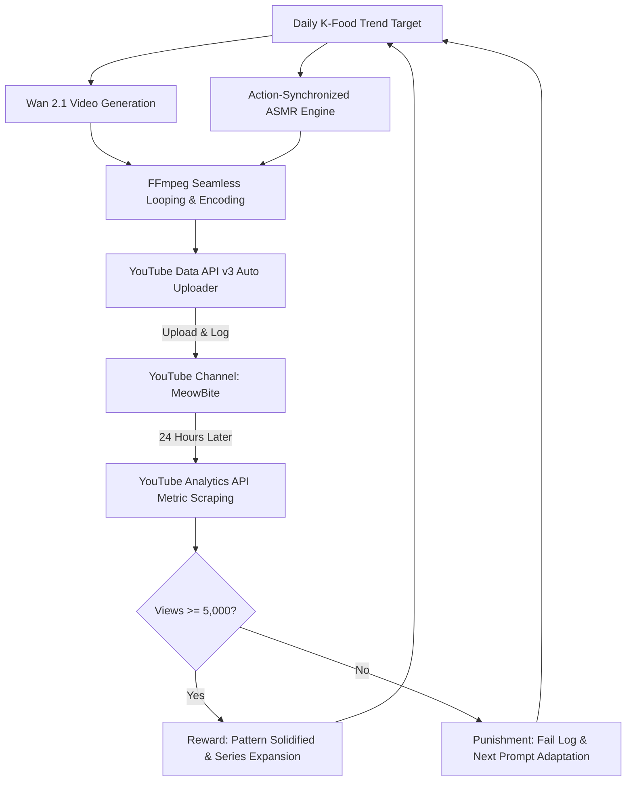
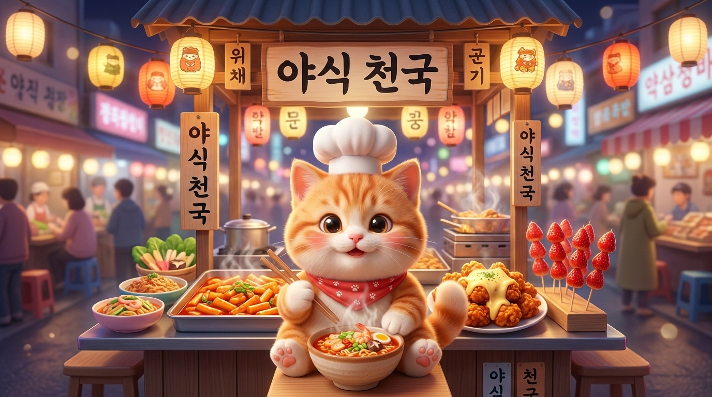

# 🐾 MeowBite AI Studio: Agent Young-sik
> **100% Autonomous YouTube Production Pipeline for Global K-Cat Mukbang Shorts**  
> Powered by **Wan 2.1 Video**, **Action-Synchronized ASMR**, **YouTube Data API v3**, and **24h Reinforcement Learning (RL)**.

---

## 📌 Executive Summary

**MeowBite AI Studio**는 전 세계 시청자를 타깃으로 매일 1개씩 한국의 대표적인 핫 트렌드 음식(K-Food)을 먹방하는 아기 고양이 셰프 쇼츠를 기획, 렌더링, 오디오 합성, 업로드 및 24시간 자율 평가까지 **100% 무인으로 수행하는 풀 오토메이션 에이전트 시스템(에이전트명: 영식 / Young-sik)**입니다.

* **공식 채널명:** `MeowBite: Daily K-Food Mukbang`
* **공식 핸들:** [`@MeowBiteKFood`](https://youtube.com/@MeowBiteKFood)
* **데뷔 1호 영상:** [YouTube에서 보기](https://www.youtube.com/watch?v=3Ax4OQT1nkw)
* **핵심 타깃:** 미국, 영국, 캐나다, 유럽, 일본 및 글로벌 쇼츠 오디언스 (언어 장벽 제로)

---

## 🏛️ System Architecture



---

## 🛠️ Core Technology Stack

| 계층 | 기술 스택 | 설명 및 비용 구조 |
| :--- | :--- | :--- |
| **비디오 엔진** | **Wan 2.1 (via Fal.ai)** | 14B 오픈 모델, 9:16 버티컬 720p 고화질 렌더링 (클립당 ~$0.05~0.08의 극가성비) |
| **오디오 엔진** | **Fal.ai MMAudio v2** | 인위적인 사람 목소리 100% 배제, 면치기·오물오물 씹기 연속 순환 리얼 먹방 ASMR ($0.001/sec) |
| **보이스 폴백** | **Edge-TTS** | 고품질 다국어/영문 성우 내레이션 엔진 (필요 시 선택적 가동) |
| **인코딩 & 믹서** | **FFmpeg (imageio-ffmpeg)** | 비디오-오디오 무한 순환 동기화, H.264 / AAC 30fps 유튜브 쇼츠 규격 최적화 |
| **배포 엔진** | **YouTube Data API v3** | Google OAuth 2.0 자동 갱신, 메타데이터 패키징, 1-Click 퍼블리싱 |
| **지능 & 기획** | **Google Gemini 2.5 Flash** | 바이럴 메뉴 선정, 프롬프트 엔지니어링, 글로벌 SEO 타이틀/태그 최적화 |
| **강화학습 (RL)** | **Autonomous Feedback Loop** | 24시간 실시간 지표(Views/Likes/Comments) 기반 Reward vs Punishment 자가 개선 |

---

## 📂 Repository Structure

```text
영상채널 에이전트 영식/
├── .agent/
│   ├── memory/
│   │   ├── punishment/             # 강화학습 오답노트 (개선점 및 실패 원인 분석)
│   │   │   └── fail_log.txt
│   │   ├── reward/                 # 강화학습 보상 기록 (성공 공식 패턴 보관)
│   │   │   └── success_log.txt
│   │   └── upload_history.json     # 업로드된 영상 ID, 메타데이터, 평가 상태 DB
│   ├── skills/
│   │   └── agent-youngsik/
│   │       └── SKILL.md            # 총괄 프로듀서 영식의 행동 강령 및 헌법
│   └── tools/
│       ├── kcat_mukbang_producer.py # [메인] 1-Click 원스톱 기획·렌더·배포 통합 툴
│       ├── wan_video_maker.py       # Wan 2.1 T2V 및 I2V 비디오 렌더러
│       ├── video_composer.py        # FFmpeg 기반 비디오-ASMR 연속 순환 믹서
│       ├── youtube_auto_uploader.py # YouTube Data API 인증 및 자동 업로더
│       ├── tts_generator.py         # Edge-TTS 영문 내레이터 유틸리티
│       └── evaluate_feedback.py     # 24시간 실시간 성과 평가 및 RL 엔진
├── knowledge/                       # [지식 베이스] 시스템 설계 및 운영 플레이북
│   ├── 01_system_architecture.md
│   ├── 02_kcat_mukbang_pipeline.md
│   ├── 03_reinforcement_learning_playbook.md
│   ├── 04_brand_identity_and_seo.md
│   └── 05_strategic_pivot_history.md
├── output_assets/                   # 생성된 프로필, 배너, 오디오 에셋
│   ├── channel_profile.jpg         # 1:1 아바타 프로필 아이콘
│   └── channel_banner.jpg          # 16:9 와이드 채널 아트 배너
├── .env.example                     # 환경 변수 템플릿
├── .gitignore                       # API 키, 토큰, 대용량 비디오 제외 규칙
└── README.md                        # 메인 지식 가이드
```

---

## 🚀 Quick Start Guide

### 1. 환경 설정
```bash
pip install fal-client google-genai google-api-python-client google-auth-oauthlib pillow python-dotenv edge-tts imageio-ffmpeg
```

### 2. `.env` 설정
`.env.example`을 복사하여 `.env` 생성 후 API 키 입력:
```env
GEMINI_API_KEY=your_gemini_api_key
FAL_KEY=your_fal_ai_key
YOUTUBE_CLIENT_SECRET_FILE=client_secret.json
```

### 3. 채널 연동 확인
```bash
python .agent/tools/youtube_auto_uploader.py --check
```

### 4. 1-Click 쇼츠 자동 제작 및 배포
```bash
python .agent/tools/kcat_mukbang_producer.py
```

### 5. 24시간 성과 평가 및 강화학습 점검
```bash
python .agent/tools/evaluate_feedback.py
```

---

## 📈 Channel Branding Assets

| 프로필 아이콘 (1:1 Avatar) | 공식 채널 아트 (16:9 Wide Banner) |
| :---: | :---: |
|  |  |
| *Chef Meow 마스코트* | *야식 천국 포장마차 전경* |

---

## 📜 License & Operational Integrity
본 프로젝트는 자율 에이전트 운영용이며, 모든 API 자격 증명(OAuth Token, API Keys)은 `.gitignore`에 의해 안전하게 보호됩니다.
