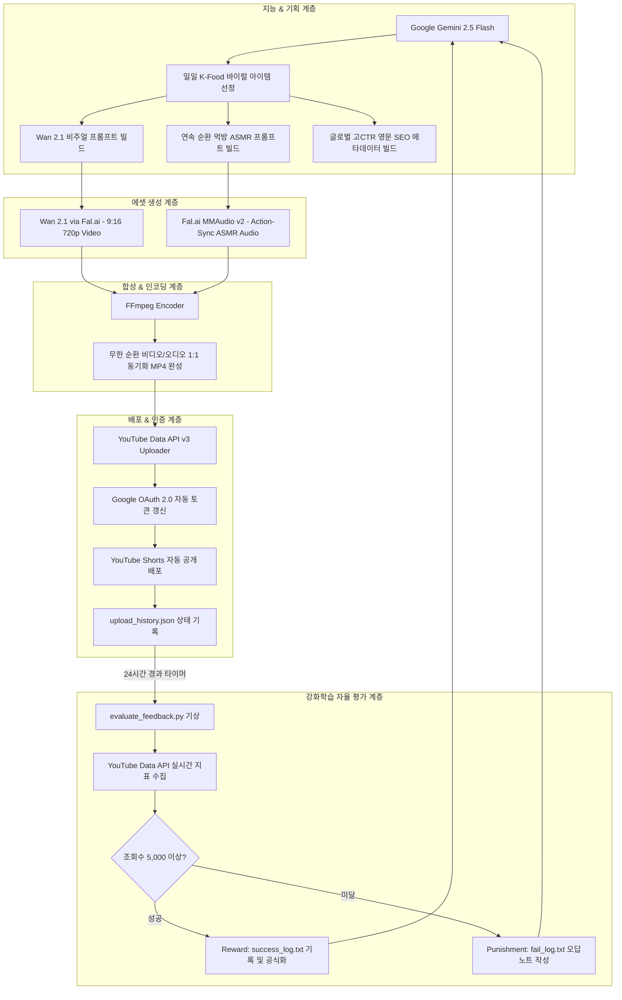

# 🏛️ Knowledge 01: System Architecture & Cost Optimization

## 1. 파이프라인 전체 구조도

---

## 2. 엔진별 비용 분석 및 가성비 비교 (Cost Economics)

| 비디오 생성 엔진 | 클립당 비용 (5~12초) | 장점 | 단점 | 에이전트 채택 여부 |
| :--- | :--- | :--- | :--- | :---: |
| **Wan 2.1 (via Fal.ai)** | **$0.05 ~ $0.08** (약 70~110원) | 14B 오픈 모델, 720p/9:16 안정적 카메라 무빙, 극강 가성비 | 서버 부하 시 큐 대기 시간 발생 | **메인 엔진 (채택)** |
| **Google Veo 3.1** | $0.20 ~ $0.50+ (약 300~700원) | 1080p 고화질 롱테이크 연장 | 클립당 비용 높음, 서버 트래픽 과부하 빈번 | 보조/폴백 엔진 |
| **MiniMax Video-01** | $0.20 ~ $0.28 (약 280~380원) | 시네마틱 디테일 우수 | 대량 데일리 양산 시 비용 누적 | 서브 대안 |

> **💡 비용 절감 성과:**  
> Veo 대비 **비용 80% 이상 절감**. 하루 1편 매일 발행 시 한 달 비디오 생성 총비용이 약 $2~$3(커피 1잔 수준)에 불과합니다.

---

## 3. 핵심 모듈 책임 분리

1. **`wan_video_maker.py`**:
   - Fal.ai 클라우드 큐와 통신하며 9:16 버티컬 비디오를 렌더링하고 `output_assets/`에 자동 다운로드.
2. **`video_composer.py`**:
   - `imageio-ffmpeg`의 고성능 바이너리를 활용하여 비디오와 오디오가 끊김 없이 액션과 맞물리도록 동기화 인코딩.
3. **`youtube_auto_uploader.py`**:
   - OAuth 2.0 클라이언트 인증 및 만료 토큰 자동 갱신 처리. Resumable Chunk 업로드 방식으로 대용량 영상 안정적 전송.
4. **`kcat_mukbang_producer.py`**:
   - 기획부터 배포까지 전 단계를 함수 한 번으로 완결하는 파이프라인 오케스트레이터.
5. **`evaluate_feedback.py`**:
   - 배포 후 실시간 통계를 추적하여 성공 패턴과 실패 패턴을 분리 누적하는 자율 강화학습 엔진.
